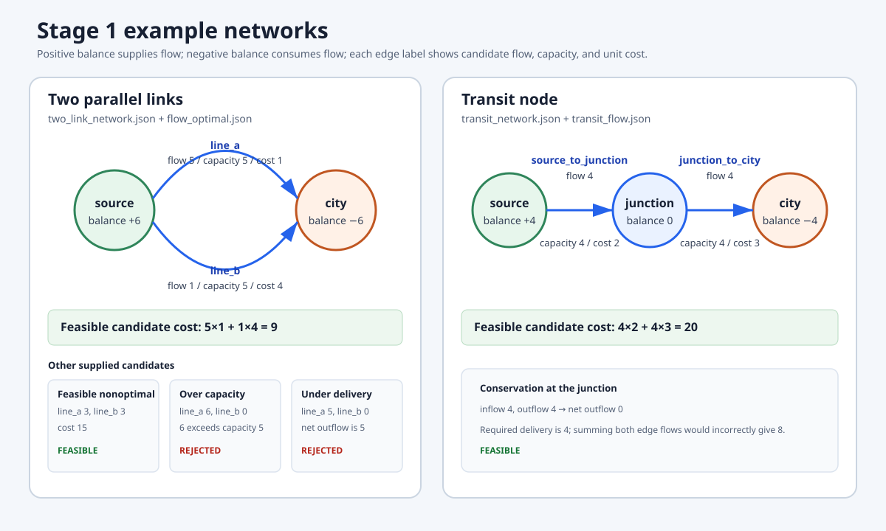

# Stage 1: Problem Definition and Validation

> **Project:** Renewable-Energy Routing - Project 6, Advanced Algorithms  
> **Repository location:** `docs/stage_01_problem_definition.md`  
> **Target:** Python 3.10  
> **Status:** Implementation specification. This document does not imply that the code already exists.  
> **Stage boundary:** Represent a flow problem and check a supplied solution. Do not implement a solver.

## 1. Instructions for Cursor

Implement Stage 1 using this document and the repository's `README.md`.

1. Inspect the existing repository before changing files. Reuse compatible code and preserve unrelated work.
2. Implement only the models, validation, cost calculation, JSON loading, example runner, and tests specified here.
3. Keep the implementation small and readable. Use type hints, short docstrings, and clear error messages.
4. Keep all code, comments, documentation, and command output in English.
5. Use the Python standard library for runtime code. Use `pytest` for tests. Do not add graph, GIS, database, or machine-learning dependencies.
6. Do not implement residual graphs, augmenting paths, maximum-flow algorithms, minimum-cost-flow algorithms, or optimization through brute-force enumeration.
7. Do not download papers or datasets. The relevant mathematical contract is included below.
8. At completion, report changed files, test commands and actual results, and any unfinished requirements. Never report unrun tests as passing.

**The central distinction:** Stage 1 evaluates a flow supplied by the caller. It does not search for a flow.

## 2. Purpose and relationship to the assignment

The final project must find an electricity-routing plan that satisfies demand at minimum total cost while respecting generation and transmission limits. The assignment also requires classical and simplified cycle-based minimum-cost-flow solvers, spatial indexing, a geospatial prediction model, experiments, and an outage demonstration.

Stage 1 establishes the shared problem definition that later solvers will use. Its deliverable is a small, tested foundation, not a completed optimization engine.

The existing README describes Stage 1 as:

- Documenting inputs, outputs, objective, and constraints.
- Defining a small example with known feasible and optimal solutions.

This specification adds a minimal executable version of those definitions: models, candidate-flow validation, and cost evaluation.

### Source-derived definitions versus repository decisions

The flow constraints and objective come from the supplied lecture and Paper 1; references are listed in Section 3. The Python APIs, file layout, JSON schema, test fixtures, and implementation restrictions below are **repository design decisions**, not requirements quoted from those sources.

In particular, the two-link example is our teaching fixture from Stage 1, not an experiment reported in either paper.

### In scope

- A directed network with node balances and edge capacities and costs.
- Validation of network data.
- Validation of an explicitly supplied edge-flow assignment.
- Calculation of the cost of a feasible assignment.
- Small deterministic fixtures, a command-line example, and unit tests.

### Out of scope

- Finding a feasible flow or proving general network infeasibility.
- Computing a minimum-cost or maximum flow.
- Residual networks, reverse residual edges, Ford-Fulkerson, or Edmonds-Karp: Stage 2.
- Successive shortest paths, cost scaling, network simplex, and cycle canceling: later stages.
- GIS coordinates, distance-based link generation, PostGIS, or learned demand estimates.
- Outage recovery, partial service, demand shedding, or curtailment optimization.
- Benchmarking solvers or reproducing the almost-linear-time algorithm.

## 3. Reading references

Use **PDF viewer page numbers**, not only the printed slide numbers.

| ID | Supplied source | Location | Use in Stage 1 |
|---|---|---|---|
| S1 | `Uploaded_Lecture07_graph_theory_advanced.pdf` | PDF page 123; printed slide 113, **Flow Networks: Definitions** | Capacity constraints and conservation at intermediate nodes. |
| S2 | Same Lecture 7 file | PDF page 124; printed slide 114, **Value of a Flow** | Maximum flow maximizes net flow leaving the source. |
| S3 | `[2025] Maximum Flow and Minimum-Cost Flow in Almost-Linear Time.pdf` | PDF page 2; printed page 19:2, **Section 1: Introduction** | Directed graph, lower/upper capacities, edge costs, prescribed node balances, and minimum-cost objective. |
| S4 | Same Paper 1 file | PDF pages 2-3; **Theorem 1.1 and Section 1.1** | Research context only; no implementation of the paper's algorithm in Stage 1. |

Lecture 7 uses `c(u, v)` for **capacity**. Paper 1 uses `c_e` for **cost**. Avoid this notation collision in code: use `capacity` and `unit_cost`.

Lecture 7 presents a single-source/single-sink maximum-flow network. This stage's model instead uses Paper 1's prescribed node-balance formulation. Do not impose the lecture's special source/sink assumptions on every `FlowNetwork` instance.

## 4. Mathematical contract

### 4.1 Problem statement

Given a directed network, prescribed supplies and demands, and edge limits and costs, the eventual optimization problem is:

> Assign a flow to every edge so that all balances and capacity constraints hold, while minimizing total cost.

Stage 1 represents this problem and checks a candidate. It does not perform the minimization.

### 4.2 Symbols and code names

| Mathematical quantity | Code name             | Meaning                          |
| --------------------- | --------------------- | -------------------------------- |
| `G = (V, E)`          | `FlowNetwork`         | The network.                     |
| `n =                  | V                     | `,` m =                          |
| `d_v` in Paper 1      | `Node.balance`        | Required net outflow at a node.  |
| `u_e^-`               | `Edge.lower_capacity` | Minimum allowed flow.            |
| `u_e^+`               | `Edge.capacity`       | Maximum allowed flow.            |
| `c_e`                 | `Edge.unit_cost`      | Cost per unit routed on an edge. |
| `f_e`                 | `flow[edge.id]`       | Candidate flow on an edge.       |

### 4.3 Node-balance convention

Use the following convention everywhere:

```text
net_outflow(v) = total_outflow(v) - total_inflow(v)
net_outflow(v) must equal node.balance

positive balance: required net supply
negative balance: required net consumption
zero balance:     transit node, or inactive node
```

This follows the incidence-matrix convention on Paper 1 page 2: an edge contributes `+1` at its tail and `-1` at its head [S3].

For example:

```text
source.balance = +6
city.balance   = -6
```

Do not interpret positive balance as consumption. Do not use a node's identifier or an optional label to determine its mathematical behavior.

The network must satisfy:

```text
sum(node.balance for every node) == 0
```

This is a necessary balance condition, **not a guarantee that a feasible routing exists**. The edges may be disconnected or have insufficient capacity.

### 4.4 Capacity constraints

For every original edge:

```text
0 <= lower_capacity <= flow[edge.id] <= capacity
```

`lower_capacity` defaults to `0`. A positive lower bound is supported by the validator; finding a flow that satisfies it is outside Stage 1.

**Repository restriction:** Paper 1 allows a more general signed lower/upper-bound formulation [S3]. For this first implementation, restrict original edge bounds and flows to nonnegative integers. This is a deliberate subset of the paper's model.

### 4.5 Objective

```text
total_cost = sum(edge.unit_cost * flow[edge.id] for every edge)
```

Every edge contributes separately, including parallel edges. `total_cost` is evaluated only after the candidate passes validation.

The source formulation minimizes this sum over all feasible flows [S3]. A function that merely computes the sum must not claim to have found its minimum.

### 4.6 Supply quantity is not available generation capacity

`Node.balance` specifies **required net injection**, not the maximum output available at a generator.

In the two-link fixture, a source can have at least 6 units available, but its prescribed balance is `+6` because the consumer requires 6 units. Do not set its balance to `+10` just because the two outgoing links together can carry 10.

For multiple generators with flexible output, a later model must represent available generation separately, for example through capacity-limited generation edges from a super-source. Do not implement that transformation here and do not automatically alter balances to make an input pass validation.

### 4.7 Units and numerical assumptions

For Stage 1, use abstract integer flow units over one fixed operating interval and integer cost units per flow unit.

- Balances, capacities, lower bounds, costs, and candidate flows must be Python integers. Reject booleans even though Python treats `bool` as a subclass of `int`.
- Do not accept or silently convert floats, numeric strings, NaN, or infinity.
- Costs may be negative, zero, or positive, consistent with the signed costs in Paper 1 [S3]. The main energy example uses positive costs.
- There is no floating-point tolerance or rounding in Stage 1.
- Treat the network as lossless. There is no storage, time expansion, voltage, impedance, or electrical power-flow calculation.
- Real-world unit conversion and scaling are later data-preparation decisions; do not invent a conversion now.

## 5. File layout

Follow the README's top-level directories. For a newly initialized repository, use:

```text
README.md
pyproject.toml
requirements-dev.txt
src/
  renewable_routing/
    __init__.py
    models.py
    validation.py
    evaluation.py
    io.py
    stage1.py
examples/
  stage1/
    two_link_network.json
    flow_optimal.json
    flow_feasible_nonoptimal.json
    flow_over_capacity.json
    flow_under_delivery.json
    transit_network.json
    transit_flow.json
tests/
  stage1/
    test_example_cases.py
    test_contract.py
    test_cli.py
docs/
  stage_01_problem_definition.md
```

Use a minimal `pyproject.toml` that makes the `src` package installable with `python -m pip install -e .` and declares Python `>=3.10`. Do not use syntax or library features introduced after Python 3.10. Runtime code has no third-party dependencies. Put `pytest` in `requirements-dev.txt`.

Do not create empty modules for future solvers or populate unrelated roadmap directories. If compatible package configuration already exists, extend it rather than replacing it.

## 6. Models and public API

### 6.1 Models

Use small dataclasses. Keep graph definitions separate from candidate flows so future solvers can operate on the same input network.

| Model | Required fields |
|---|---|
| `Node` | `id: str`, `balance: int` |
| `Edge` | `id: str`, `source: str`, `target: str`, `capacity: int`, `unit_cost: int`, `lower_capacity: int = 0` |
| `FlowNetwork` | `nodes: tuple[Node, ...]`, `edges: tuple[Edge, ...]` |
| `FlowEvaluation` | `total_cost: int`, `net_outflow: dict[str, int]` |

Use `frozen=True` for `Node`, `Edge`, and `FlowNetwork`. Perform domain validation in the validation functions rather than hiding it in constructors.

A candidate flow is a mapping from **edge ID** to integer flow:

```python
flow = {"line_a": 5, "line_b": 1}
```

Do not store the flow on `Edge`, and do not key edges only by `(source, target)`: the example deliberately has two distinct links with the same endpoints.

Allow distinct original edges in opposite directions. They remain separate original edges with separate IDs, limits, and costs. Do not create or treat either as a reverse residual edge in Stage 1.

### 6.2 Required functions

The following are API contracts, not implementations:

```python
# validation.py
from collections.abc import Mapping
from .models import FlowNetwork


def validate_network(network: FlowNetwork) -> None: ...


def validate_flow(
    network: FlowNetwork,
    flow: Mapping[str, int],
) -> None: ...
```

```python
# evaluation.py
from collections.abc import Mapping
from .models import FlowEvaluation, FlowNetwork


def evaluate_flow(
    network: FlowNetwork,
    flow: Mapping[str, int],
) -> FlowEvaluation: ...
```

```python
# io.py
from pathlib import Path
from .models import FlowNetwork


def load_network(path: str | Path) -> FlowNetwork: ...


def load_flow(path: str | Path) -> dict[str, int]: ...
```

`FlowNetwork` and `FlowEvaluation` must not expose `is_optimal`, `optimal_cost`, `solved`, or a fabricated solver result in this stage.

## 7. Validation and error behavior

### 7.1 `validate_network`

Return `None` for a structurally valid network. Raise `ValueError` for a domain error.

Validate the following before converting nodes or edges into lookup dictionaries:

- At least one node exists; node IDs are nonempty, non-whitespace-only strings and are unique.
- Edge IDs are nonempty, non-whitespace-only strings and are unique.
- Every edge endpoint references an existing node.
- All numeric model fields are integers, excluding booleans.
- `0 <= lower_capacity <= capacity` for every edge.
- The sum of all node balances is exactly zero.
- Self-loops (`source == target`) are rejected as a Stage 1 simplification, not as a claim that general flow models forbid them.

Parallel edges, opposite-direction original edges, zero-capacity edges, and signed costs are allowed.

An empty edge list and isolated nodes are allowed. Do not require connectivity or claim to have checked global feasibility.

### 7.2 `validate_flow`

First validate the network. Then check:

1. The mapping contains exactly the network's edge IDs: no missing or unknown IDs. Even a zero flow must be explicit.
2. Every flow value is an integer, excluding booleans.
3. Every flow satisfies its edge's lower and upper limits.
4. Every node satisfies `outflow - inflow == balance`.

Initialize a net-outflow counter to zero for **every node**, including isolated nodes. For each edge with assigned flow `f`:

```text
net_outflow[edge.source] += f
net_outflow[edge.target] -= f
```

Compare each final counter with that node's required balance. Do not sum all edge flows and call that the delivered amount: flow passing through two links is counted twice in that sum.

Do not mutate the network or the supplied flow mapping.

### 7.3 `evaluate_flow`

Validate the network and candidate, then return their total cost and the net-outflow dictionary.

A feasible but expensive candidate must be accepted. Its cost is not a validation error.

An invalid candidate must raise an exception rather than return a partial cost or a misleading success result. Shared internal helpers are fine; avoid unnecessary repeated work.

For the validators and evaluator, aim for a constant number of passes over nodes and edges, using dictionaries for lookup. The intended work is linear in the number of nodes and edges under ordinary dictionary and arithmetic operation assumptions. No path search or matrix construction is necessary.

### 7.4 Error semantics

Fail on the first detected error with a useful `ValueError`. Include the relevant node or edge ID and the conflicting values where applicable. Tests may check informative substrings rather than entire messages.

Examples:

```text
Duplicate edge ID: line_a
Unknown target node 'missing_city' on edge 'line_a'
Edge 'line_a': flow 6 exceeds capacity 5
Edge 'line_a': flow 0 is below lower_capacity 1
Node 'city': expected net outflow -6, received -5
```

Keep these distinctions explicit:

| Outcome | What Stage 1 can conclude |
|---|---|
| Invalid network data | The input violates the model contract. |
| Invalid candidate flow | This particular assignment violates a constraint. Another assignment might work. |
| Valid candidate flow | This assignment is feasible. Optimality has not been checked. |
| No feasible assignment exists | A global property. Stage 1 does not implement an algorithm to determine it. |

An invalid candidate does not prove network infeasibility. A valid candidate does demonstrate that at least one feasible flow exists, but not that it is cheapest.

## 8. JSON input contract

### 8.1 Network schema

The top-level object contains exactly `nodes` and `edges`, each an array.

Each node requires `id` and `balance`. Each edge requires `id`, `source`, `target`, `capacity`, and `unit_cost`; only `lower_capacity` is optional, defaulting to `0`.

Reject missing required fields, unexpected fields, wrong JSON shapes, and wrong field types with useful errors. Do not silently repair typos or coerce values. Check duplicate IDs while records are still in lists.

`load_network` parses the JSON, constructs the dataclasses, validates the network, and returns it.

### 8.2 Candidate schema

A flow file is a JSON object mapping edge IDs directly to integer values, with no wrapper object.

`load_flow` checks the object shape and integer values. It cannot check membership, bounds, or node balances without a network; those checks belong to `validate_flow` and `evaluate_flow`.

Malformed JSON may raise `json.JSONDecodeError`; missing or unreadable files may raise `OSError`. The command-line runner handles these errors without a traceback for ordinary input mistakes.

## 9. Required fixtures and expected results

The diagram below visualizes the exact Stage 1 example networks and supplied
candidate flows. Edge labels show `flow / capacity / unit cost`; the additional
candidate cards summarize the remaining two-link flow fixtures.



For a compact, data-driven demonstration of every fixture outcome, run:

```bash
python examples/stage1/run_cases.py
```

The runner reads `examples/stage1/cases.json`, evaluates only the supplied
candidates, and explains why each candidate is accepted or rejected. It is a
stage-specific demonstration, not a flow solver or a replacement for the
required contract tests.

### 9.1 Primary example: two parallel links

Save as `examples/stage1/two_link_network.json`:

```json
{
  "nodes": [
    {"id": "source", "balance": 6},
    {"id": "city", "balance": -6}
  ],
  "edges": [
    {
      "id": "line_a",
      "source": "source",
      "target": "city",
      "capacity": 5,
      "unit_cost": 1,
      "lower_capacity": 0
    },
    {
      "id": "line_b",
      "source": "source",
      "target": "city",
      "capacity": 5,
      "unit_cost": 4,
      "lower_capacity": 0
    }
  ]
}
```

Save these four separate candidate files:

| File | Exact JSON contents | Expected evaluation |
|---|---|---|
| `flow_optimal.json` | `{"line_a": 5, "line_b": 1}` | Feasible; total cost `9`. |
| `flow_feasible_nonoptimal.json` | `{"line_a": 3, "line_b": 3}` | Feasible; total cost `15`. |
| `flow_over_capacity.json` | `{"line_a": 6, "line_b": 0}` | Rejected: `line_a` exceeds capacity. |
| `flow_under_delivery.json` | `{"line_a": 5, "line_b": 0}` | Rejected: required node balances are not met. |

For the first candidate, the expected evaluation fields are:

```python
total_cost = 9
net_outflow = {"source": 6, "city": -6}
```

The filename `flow_optimal.json` records a **manually established fixture property**. The evaluator must not infer or report optimality from the filename.

### 9.2 Manual justification for the fixture's optimum

Let `a` and `b` be the flows on `line_a` and `line_b`.

```text
a + b = 6
0 <= a <= 5
0 <= b <= 5
cost = a + 4*b = a + 4*(6 - a) = 24 - 3*a
```

Every feasible assignment has `a <= 5`, so its cost is at least `24 - 3*5 = 9`. The assignment `(a, b) = (5, 1)` is feasible and attains 9. Therefore 9 is the true optimum for this fixture.

This is a proof for one example, not a general optimization algorithm. Do not add hard-coded selection of this assignment to the evaluator.

For comparison only, the two links could carry 10 units if the source supplied 10 and the receiver accepted 10. That maximum-throughput question is not the fixed-demand problem encoded in this JSON file.

### 9.3 Transit-node fixture

Save as `examples/stage1/transit_network.json`:

```json
{
  "nodes": [
    {"id": "source", "balance": 4},
    {"id": "junction", "balance": 0},
    {"id": "city", "balance": -4}
  ],
  "edges": [
    {
      "id": "source_to_junction",
      "source": "source",
      "target": "junction",
      "capacity": 4,
      "unit_cost": 2
    },
    {
      "id": "junction_to_city",
      "source": "junction",
      "target": "city",
      "capacity": 4,
      "unit_cost": 3
    }
  ]
}
```

Save as `examples/stage1/transit_flow.json`:

```json
{
  "source_to_junction": 4,
  "junction_to_city": 4
}
```

Expected result:

```text
net_outflow = {source: 4, junction: 0, city: -4}
total_cost = 4*2 + 4*3 = 20
```

The delivered quantity is 4, not the sum of edge flows, which is 8.

### 9.4 Balanced input does not guarantee feasibility

Construct a test network with balances `source: +6`, `city: -6` and a single edge of capacity 5 and unit cost 1.

- `validate_network` succeeds: the data is structurally valid and balances sum to zero.
- A supplied flow of 5 fails candidate validation because it does not meet the prescribed balances.
- We can manually see that the capacity is insufficient, but Stage 1 does not implement a general infeasibility detector.

Do not add hidden feasibility-solving logic to `validate_network`.

## 10. Command-line behavior

Implement `stage1.py` as a small example runner using `argparse`, with two positional arguments: a network JSON path and a flow JSON path.

After the stage is implemented, the following command must work from the repository root:

```bash
python -m renewable_routing.stage1 \
  examples/stage1/two_link_network.json \
  examples/stage1/flow_optimal.json
```

Expected successful output:

```text
Network structure: valid
Candidate flow: feasible
Total required supply: 6
Total required demand: 6
Total cost: 9
Optimality: not checked
```

Calculate required supply as the sum of positive balances and required demand as the absolute sum of negative balances. These are input requirements, not solver-computed maximum-flow values.

For `flow_feasible_nonoptimal.json`, success is still correct and the cost must be 15.

For invalid network data or an invalid candidate, print an informative `ERROR:` message to standard error and exit with code `1`. Do not label the entire network infeasible solely because a candidate failed. Do not print a cost as if it belonged to a feasible solution.

Success exits with code `0`. Ordinary command-line usage errors can retain `argparse`'s standard exit code `2`. Catch expected input/file errors; do not hide programming errors with a blanket exception handler.

## 11. Required tests

Use deterministic tests. No external service, network request, or reference flow solver is needed.

| ID | Test | Required result |
|---|---|---|
| T01 | Load and evaluate the primary candidate `(5, 1)`. | Feasible, cost 9, balances `+6` and `-6`. |
| T02 | Evaluate the nonoptimal candidate `(3, 3)`. | Feasible, cost 15; no optimality claim. |
| T03 | Evaluate `(6, 0)`. | Capacity error. |
| T04 | Evaluate `(5, 0)`. | Node-balance error. |
| T05 | Supply a negative edge flow. | Rejected. |
| T06 | Omit a flow ID or add an unknown ID. | Rejected in both cases; no implicit zero. |
| T07 | Duplicate node ID or duplicate edge ID in input lists. | Rejected before lookup dictionaries overwrite records. |
| T08 | Reference a nonexistent endpoint. | Rejected with the edge and endpoint identified. |
| T09 | Use node balances whose sum is not zero. | Network validation rejects them. |
| T10 | Use negative capacity, negative lower bound, or lower bound greater than capacity. | Rejected. |
| T11 | Use floats, booleans, or numeric strings in numeric fields. | Rejected; no coercion. |
| T12 | Evaluate the transit fixture. | Feasible; junction net outflow 0; cost 20. |
| T13 | Set `line_a.lower_capacity = 2`. Evaluate `(1, 5)` and `(2, 4)`. | First rejected; second feasible, cost 18. |
| T14 | Set `line_a.unit_cost = -1`; evaluate `(5, 1)`. | Accepted; cost -1. |
| T15 | Use the two parallel edges from the main fixture. | Both remain distinct; neither is overwritten or merged. |
| T16 | Use opposite-direction original edges as described below. | Net balance and cost include both edges independently. |
| T17 | Use the balanced, capacity-insufficient network in Section 9.4. | Network validation passes; the supplied flow fails. |
| T18 | One node with balance 0, no edges, and an empty flow. | Feasible; net outflow 0; cost 0. |
| T19 | No nodes, or a self-loop. | Rejected under the Stage 1 model contract. |
| T20 | Malformed JSON, missing required fields, unexpected fields, wrong top-level shape, or missing file. | Useful exceptions/messages; CLI exits nonzero. |
| T21 | Evaluate the same inputs twice and change mapping insertion order. | Same result, with no input mutation. |
| T22 | Run the CLI with valid and invalid fixture files. | Expected output and exit codes; invalid candidates are not called optimal or globally infeasible. |

For T16, use nodes with balances `u: +3`, `v: -3`. Add `forward: u -> v` with capacity 5 and cost 2, and `return: v -> u` with capacity 2 and cost 1. The candidate `forward: 4`, `return: 1` is feasible and has cost `4*2 + 1*1 = 9`. These are two original edges, not a residual-edge pair.

Parametrized tests may group related cases. Test behavior, not a particular internal implementation. Do not use the same production helper to manufacture the expected answer being asserted.

## 12. Implementation order and acceptance criteria

### Step 1: Establish the package

Add the minimal package configuration, development dependency, and package directory. Confirm that imports work after an editable installation.

### Step 2: Add models and network validation

Implement the dataclasses and structural validator. Add tests for identities, endpoints, numeric types, limits, and total balance.

### Step 3: Add candidate validation and evaluation

Implement exact edge-ID matching, per-edge bounds, net-outflow accounting, and total cost. Add the valid and invalid candidate tests.

### Step 4: Add JSON fixtures and loading

Create the fixture files with the exact values above. Make validation errors understandable for JSON users as well as direct Python callers.

### Step 5: Add the runner and finish tests

Implement the command-line behavior, run the test suite, and verify the example commands. Update only the relevant README sections with the actual Stage 1 setup and run commands.

Use these commands after activating the Python 3.10 environment described in the README:

```bash
python -m pip install -e .
python -m pip install -r requirements-dev.txt
python -m pytest -q
python -m renewable_routing.stage1 examples/stage1/two_link_network.json examples/stage1/flow_optimal.json
python -m renewable_routing.stage1 examples/stage1/transit_network.json examples/stage1/transit_flow.json
```

### Definition of done

- [ ] The package installs and runs with Python 3.10.
- [ ] The positive-supply/negative-demand convention is documented and tested.
- [ ] Network validation and candidate validation remain distinct.
- [ ] Parallel edges are supported through unique edge IDs.
- [ ] The primary example evaluates to cost 9 and the nonoptimal example to cost 15.
- [ ] The transit example evaluates to cost 20 and enforces conservation.
- [ ] All required valid and invalid cases are covered by passing tests.
- [ ] The CLI reports feasibility and cost without claiming optimality.
- [ ] Runtime code has no third-party dependencies and does not mutate inputs.
- [ ] The README reflects only functionality actually implemented.
- [ ] No solver, residual network, GIS integration, or machine-learning code has been added.

**Stop here.** Stage 2 will introduce residual networks and maximum-flow algorithms. Its maximum-flow problem definition must be kept distinct from this fixed-balance minimum-cost-flow model; do not force intermediate maximum-flow states to satisfy prescribed final balances.

## 13. Short review questions and answers

**1. What problem will the project ultimately solve?**  
Find a minimum-cost routing that meets demand and respects generation and transmission limits.

**2. What does Stage 1 receive and return?**  
It receives a network and a candidate flow. It returns the candidate's cost and node net outflows if all constraints hold, or raises a validation error.

**3. How does minimum-cost flow differ from maximum flow?**  
Maximum flow maximizes delivery. Minimum-cost flow minimizes cost while satisfying specified supplies and demands.

**4. Why check both capacities and node balances?**  
Capacities limit individual links; node balances enforce the required net supply, demand, or conservation at each node.

**5. Does passing validation prove optimality?**  
No. It proves this candidate is feasible. Failing validation also does not prove that every possible candidate is infeasible.
